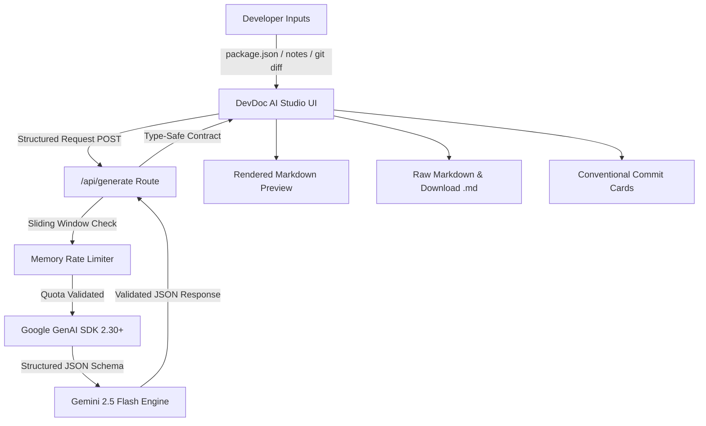

<div align="center">

# ⚡ DevDoc AI
### Smart README & Conventional Commit Studio for Modern Engineering Teams

[](https://nextjs.org/)
[](https://react.dev/)
[](https://tailwindcss.com/)
[](https://ai.google.dev/)
[](https://www.typescriptlang.org/)
[](https://opensource.org/licenses/MIT)

<p align="center">
  <b>Eliminate documentation debt and chaotic Git histories in seconds.</b><br/>
  DevDoc AI transforms messy project notes, <code>package.json</code> files, and raw <code>git diff</code> outputs into publication-grade Markdown READMEs and semantic Conventional Commits using Google Gemini's structured output schema engine.
</p>

[Explore Live Studio](#-quickstart) • [Features](#-core-features) • [Architecture](#-architecture--data-flow) • [API Specification](#-api-specification) • [Contributing](#-contributing)

---

</div>

## 🌟 Core Features

### 📘 Smart README Architect
- **Zero-to-Hero Documentation:** Converts `package.json`, `requirements.txt`, or brief bullet points into comprehensive, badge-adorned GitHub READMEs.
- **Architectural Depth:** Automatically structures Overview, Tech Stack, Features Matrix, Installation Steps, Environment Variables, and API References.
- **Formatted vs. Raw Previews:** Dual-mode studio viewer with one-click Markdown export and instant clipboard syncing.
- **Auto-Generated Repository Tags:** Recommends relevant GitHub topic tags (e.g., `#nextjs16`, `#gemini-api`, `#developer-tools`).

### ⚡ Conventional Commit Studio
- **Diff-Aware Semantic Intelligence:** Analyzes Git diffs and code patch descriptions to categorize changes into standard Conventional Commit types: `feat`, `fix`, `docs`, `refactor`, `perf`, `chore`.
- **Granular Scopes & Headers:** Formats precise semantic commit lines (e.g., `feat(auth): implement argon2 password hashing with rate-limiting`).
- **Technical Reasoning:** Supplies clear, context-rich body explanations describing the *why* and *how* behind each change.
- **One-Click Terminal Command:** Instantly copy formatted `git commit -m "..."` commands directly to your clipboard.

### 🛡️ Enterprise Security & Privacy
- **Zero Token Leakage Protocol:** Local environment credentials (`.env.local`) are strictly isolated and permanently blocked from Git tracking via `.gitignore`.
- **IP-Based Sliding Rate Limiter:** Protects upstream API quotas against abuse without requiring user session authentication.

---

## 🏛️ Architecture & Data Flow



---

## 🚀 Quickstart

### Prerequisites
- **Node.js**: `v20.x` or higher
- **Package Manager**: `npm`, `pnpm`, or `yarn`
- **Google Gemini API Key**: Obtain a free key from [Google AI Studio](https://aistudio.google.com/)

### 1. Clone the Repository
```bash
git clone https://github.com/Almaskhan19/Smart-README-Commit-Generator.git
cd Smart-README-Commit-Generator/devdoc-ai
```

### 2. Install Dependencies
```bash
npm install
```

### 3. Configure Environment Variables
Create a local `.env.local` file in the `devdoc-ai` root directory:
```bash
cp .env.example .env.local
```
Add your Gemini API key:
```env
GEMINI_API_KEY=your_actual_gemini_api_key_here
```

### 4. Launch Development Server
```bash
npm run dev
```
Open [http://localhost:3000](http://localhost:3000) in your browser.

---

## 🧩 Tech Stack

| Layer | Technology | Version | Purpose |
| :--- | :--- | :--- | :--- |
| **Framework** | [Next.js](https://nextjs.org/) | `16.4.2` | App Router, Turbopack, React Server Components |
| **Library** | [React](https://react.dev/) | `19.3.0` | Modern UI primitives, hooks, state management |
| **Styling** | [Tailwind CSS](https://tailwindcss.com/) | `v4.0.0` | CSS-first dynamic theme engine |
| **AI Intelligence** | [@google/genai](https://github.com/google-gemini/generative-ai-js) | `^2.30.0` | Official Google GenAI SDK with JSON schema enforcement |
| **Model** | [Gemini 2.5 Flash](https://ai.google.dev/) | `Latest` | Ultra-fast reasoning & structured JSON outputs |
| **Icons** | [Lucide React](https://lucide.dev/) | `^1.60.0` | Crisp SVG icon set |
| **Language** | [TypeScript](https://www.typescriptlang.org/) | `^5.0.0` | Strict end-to-end type safety |

---

## 🔌 API Specification

### `POST /api/generate`

#### 1. README Mode Request
```json
{
  "mode": "readme",
  "projectTitle": "HyperLog Engine",
  "rawInput": "High throughput distributed log ingestion daemon in Rust with RocksDB persistence."
}
```

#### README Mode Response
```json
{
  "mode": "readme",
  "readme": {
    "markdown": "# ⚡ HyperLog Engine\n\nHigh throughput distributed log ingestion daemon...",
    "suggestedTags": ["rust", "distributed-systems", "database", "storage-engine"]
  }
}
```

#### 2. Commit Mode Request
```json
{
  "mode": "commit",
  "rawInput": "Modified app/api/auth.ts: added argon2 password hashing and 10 req/min rate limit"
}
```

#### Commit Mode Response
```json
{
  "mode": "commit",
  "commits": [
    {
      "type": "feat",
      "scope": "auth",
      "subject": "implement argon2 password hashing and rate limiting",
      "fullHeader": "feat(auth): implement argon2 password hashing and rate limiting",
      "bodyExplanation": "Upgrades credentials security with Argon2 hashing and applies a 10 req/min sliding window rate limit to mitigate brute-force attempts."
    }
  ]
}
```

---

## 🛡️ Project Directory Structure

```plaintext
devdoc-ai/
├── app/
│   ├── api/generate/route.ts   # Edge-ready generation endpoint with GenAI SDK
│   ├── globals.css             # Tailwind v4 theme, custom dark scrollbars
│   ├── layout.tsx              # Geist font loading & metadata configuration
│   └── page.tsx                # Interactive split-screen studio workspace
├── components/
│   └── MarkdownPreview.tsx     # Custom styled GitHub Markdown parser & renderer
├── lib/
│   └── rate-limit.ts           # In-memory sliding window rate limiter
├── types/
│   └── generator.ts            # Type-safe request and response contracts
├── public/                     # Static assets & icons
├── .env.example                # Safe environment template
├── package.json                # Project dependencies and run scripts
└── tsconfig.json               # Strict TypeScript configuration
```

---

## 🤝 Contributing

Contributions, issues, and feature requests are warmly welcomed!
Feel free to check the [issues page](https://github.com/Almaskhan19/Smart-README-Commit-Generator/issues).

1. **Fork the Project**
2. **Create your Feature Branch** (`git checkout -b feature/AmazingFeature`)
3. **Commit your Changes** (`git commit -m 'feat(editor): add dark/light mode toggle'`)
4. **Push to the Branch** (`git push origin feature/AmazingFeature`)
5. **Open a Pull Request**

---

## 📄 License

Distributed under the **MIT License**. See `LICENSE` for more information.

<div align="center">
  <sub>Engineered with ❤️ by <a href="https://github.com/Almaskhan19">Almas Khan</a>. Powered by Google Gemini.</sub>
</div>
